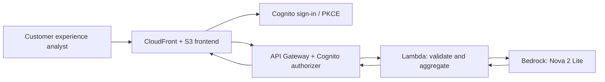

# Customer Feedback Intelligence — Adobe FDE take-home

A fictional Prada-inspired workflow for non-technical customer-experience analysts. **Not affiliated with Prada or Adobe.** All included feedback is synthetic.

**Live demo:** [projectrazvan.click/prada/index.html](https://projectrazvan.click/prada/index.html) (requires a provisioned Cognito test user; public signup is disabled).

## Quick start — run code without an AWS account

Clone the repository, then run these checks from the project root with **Python 3.12+** and **Node.js 18+**:

```bash
python -m unittest discover -s tests -p 'test_lambda_function.py' -v
node tests/test_frontend_csv.cjs
```

To invoke the Lambda entry point entirely offline using the built-in deterministic mock:

```bash
USE_MOCK_AI=true python -c "import sys,json; sys.path.insert(0,'backend'); from lambda_function import lambda_handler; event={'feedback':[{'feedback_id':'FB001','comment':'Delivery was delayed','market':'Italy','product_category':'Handbags','channel':'Survey'}]}; print(json.dumps(lambda_handler(event,None),indent=2))"
```

The **real AI demonstration** requires an AWS Bedrock-enabled account plus API Gateway/Cognito configuration below. The Python tests and local mock do not make Bedrock calls.

**For the interviewer:** [Architecture decisions](docs/architecture.md) · [Business case](docs/BUSINESS_CASE.md) · [Interview walkthrough](docs/INTERVIEW_GUIDE.md) · [Submission checklist](docs/GITHUB_SUBMISSION_CHECKLIST.md).


## Business problem and value

A customer-experience analyst receives feedback from surveys, product reviews, and support interactions. The analyst needs to identify recurring problems, trace findings back to comments, and plan investigations. This tool classifies up to 20 feedback records per request and creates a compact, evidence-linked briefing.

## Workflow

1. Analyst signs in with Cognito.
2. Analyst uploads a CSV (`feedback_id`, `comment`; optional `date`, `channel`, `market`, `product_category`) using the **Download CSV template** link if needed. The dashboard loads **zero** records until the analyst uploads a file.
3. Browser sends selected records to `POST /feedback/analyze` with a Cognito ID token.
4. API Gateway Cognito authorizer verifies the token; AWS Lambda validates input and calls Nova 2 Lite through Amazon Bedrock.
5. Lambda validates returned classifications, **calculates recurring issue counts and source IDs deterministically**, and optionally invokes a *second* Bedrock step for a narrative summary and suggested investigations.
6. Browser displays sentiment, recurring issues, AI briefing, suggested investigations, and **market, product-category and feedback-channel breakdowns**, each with verified record counts and links to supporting feedback IDs. The feedback evidence table shows all three input dimensions.

## Architecture



Browser (S3 + CloudFront) → Cognito hosted login (authorization code + PKCE) → API Gateway REST + Cognito user-pool authorizer → Python Lambda → Amazon Bedrock Nova 2 Lite. Lambda logs token use and model latency to CloudWatch. No feedback database in this MVP; results are only kept in memory in the browser.

## Repository

- `frontend/index.html`, `styles.css`, `app.js`, `config.js`: static frontend, API calling, parsing and Cognito PKCE
- `frontend/sample_feedback.csv`: 16 **synthetic** records, not automatically loaded; `feedback_template.csv`: empty header-only CSV template for analysts
- `backend/lambda_function.py`: validation, model calls, recurring issue calculation, defensive fallbacks
- `tests/test_lambda_function.py`: unit tests (mocked model and negative cases)
- `tests/test_frontend_csv.cjs`: Node-based CSV parser and UI configuration smoke tests
- `docs/architecture.md`: architectural decisions
- `docs/BUSINESS_CASE.md`: complete assumed customer context and MVP acceptance criteria
- `docs/INTERVIEW_GUIDE.md`: reproducible demonstration and trade-off discussion
- `.github/workflows/ci.yml`: automatic checks on pushes and pull requests
- `scripts/package_lambda.py`: packages the backend Lambda handler using Python's standard library

## Local testing

Requires Python 3.12+ and Node 18+; no local AWS credentials required for mock tests.

```bash
python -m unittest discover -s tests -p 'test_lambda_function.py' -v
node tests/test_frontend_csv.cjs
```

Try the handler locally in mock mode:

```bash
USE_MOCK_AI=true python - <<'PY'
import sys, json
sys.path.insert(0, 'backend')
from lambda_function import lambda_handler
print(json.dumps(lambda_handler({'feedback': [{'feedback_id': 'FB001', 'comment': 'Delivery was delayed'}]}, None), indent=2))
PY
```

You can serve the static frontend locally (`python -m http.server 8000 --directory frontend`), but actual Cognito sign-in requires the exact localhost callback URL to be configured in Cognito; otherwise use the hosted AWS frontend. Frontend always requires sign-in before calling the remote AI endpoint.

## AWS deployment

1. Create a Python 3.14 Lambda named `prada-feedback-analyzer`, with handler `lambda_function.lambda_handler`. Run `python scripts/package_lambda.py` to create `dist/prada-feedback-analyzer.zip`, then upload that archive through Lambda → Code → Upload from ZIP.
2. Configure `USE_MOCK_AI=false`, `MODEL_ID=eu.amazon.nova-2-lite-v1:0`, `ALLOWED_ORIGIN=https://projectrazvan.click`, and a ~30-second timeout (monitor timeout vs API Gateway integration limit).
3. Permit the Lambda role to invoke the selected Bedrock inference profile and its model ARNs using `bedrock:InvokeModel` (least privilege). AWS console / account model access must be enabled.
4. Create a REST API Gateway `POST /feedback/analyze` with **Lambda proxy integration** and a Cognito user-pool authorizer. With no method authorization scopes configured, the browser submits the Cognito ID token.
5. Configure unauthenticated `OPTIONS` preflight with `Access-Control-Allow-Origin: https://projectrazvan.click`, methods `OPTIONS, POST`, and headers `Content-Type, Authorization`. Configure gateway error CORS separately.
6. Create a Cognito SPA/public app client (no secret), hosted domain and exact callback/signout URL `https://projectrazvan.click/prada/index.html`. Enable authorization-code + PKCE with `openid` and `email` scopes. Create a test user; do not enable public signup for this demo.
7. Edit `frontend/config.js` to use your own Cognito domain, public app-client ID, exact callback URL, and API endpoint (only public identifiers). Upload contents of `frontend/` to the `prada/` prefix in the S3 bucket served by CloudFront. Invalidate `/prada/*` after updates.
8. Test login, CSV upload, analysis, all three segment breakdowns and evidence jumps. Restrict API and Bedrock invocation costs; do not use real personal customer feedback.

**Infrastructure limitation:** The AWS deployment was configured manually in AWS Console, rather than fully defined in infrastructure-as-code. The application code, tests, mock mode, and Lambda ZIP packaging are reproducible from this repository; reproducing the *cloud infrastructure* requires the documented manual AWS setup. We intentionally avoided adding an untested infrastructure template solely for the interview.

## AI responsibilities and reliability

**Deterministic code:** input limits, feedback ID preservation and duplicate rejection, theme/sentiment allowlist, issue counts, segmentation by exact uploaded `market`, `product_category`, and `channel` values, negative-feedback ratios, supporting IDs, and output validation. **LLM:** sentiment/issue theme for each record, concise narrative summary, optional investigative wording by segment, and explicit uncertainty. If segment wording is absent or invalid, deterministic investigative prompts remain available. AI does **not** create authoritative segmentation statistics. The LLM may not set trusted issue counts or choose authoritative issue IDs. The second Bedrock call is optional: failure returns `executive_insights.status='unavailable'` while classifications remain available. Frontend also gracefully supports older Lambda responses without `executive_insights`.

## Trade-offs and known limitations

- Restricted to **20 feedback items per synchronous request** to bound latency and cost; no pagination or background jobs.
- A 100% negative share for a channel or category in an uploaded batch of 1–2 comments does **not** mean all that channel's customers are dissatisfied. Samples are not representative and channels are self-selected. Small samples cannot establish prevalence, causes, or operational responsibility. Suggested actions require human review.
- A **single theme per record** is a simplifying assumption that loses mixed-issue feedback; taxonomy should be evaluated and potentially extended to multi-label classification.
- The model can still generate false interpretations despite IDs and schema validation. Grounding and quality must be evaluated on a labeled dataset before production.
- Each AI analysis makes up to **two Bedrock requests**, raising latency and inference cost. The segmentation aggregation is computed locally and requires no extra model call. Add batching, timeouts, token metrics, and offline evaluation for production.
- User tokens live only in memory; refresh requires sign-in. No persisted analysis state or analyst approval workflow.
- CloudWatch logs structured metrics without raw comments; personal data policy, retention, monitoring, rate limits, budgets and infrastructure-as-code need further work.
- This is an independent concept demo, not a description of Prada's actual customer service systems or data.

## AI-assisted development disclosure

**AI tool used:** ChatGPT assisted throughout ideation, design, coding, testing, and documentation. AI-assisted code and recommendations were iteratively reviewed, adapted, and tested against the working AWS deployment; generated output was not treated as automatically correct.

- **Ideation:** Helped evaluate customer-facing AI workflow ideas and refine the fictional luxury-retail customer-feedback problem into a focused MVP for non-technical customer-experience analysts.
- **Architecture and design:** Helped explore the serverless AWS architecture (CloudFront/S3, Cognito, API Gateway, Lambda, and Bedrock), authentication flow, request/response contracts, and separation between generative interpretation and deterministic business logic.
- **Coding:** Assisted in drafting and refining the Python Lambda handler, Bedrock structured-output integration, JavaScript dashboard, CSV ingestion, and breakdowns by market, product category, and feedback channel.
- **Testing and troubleshooting:** Assisted in writing Python unit tests and JavaScript CSV/UI checks, defining negative test cases, checking model-output validation, and diagnosing deployment issues such as CORS configuration. Tests run without calling Bedrock; the end-to-end workflow was also exercised in AWS.
- **Documentation:** Helped draft and organize this README, the business case, architecture decisions, deployment instructions, trade-offs, and interview notes.

**Where AI was deliberately not relied upon:**

- **Authoritative calculations:** The language model does not generate trusted counts, ratios, rankings, or evidence-ID mappings. Lambda derives these deterministically from the uploaded records and validated classifications.
- **Authentication and authorization:** Cognito and the API Gateway authorizer enforce access; a prompt is never treated as a security control. The frontend contains no AWS credentials or Cognito client secret.
- **Output validity:** The Lambda handler checks feedback IDs, allowed sentiment/theme values, response structure, and cited evidence IDs instead of accepting model output at face value. These safeguards do not guarantee that a semantically plausible classification is correct.
- **Business decisions:** AI-generated investigative recommendations are suggestions for an analyst, not verified root causes, company policy, or autonomous decisions. Small samples are explicitly identified as non-representative.
- **Independent verification:** Core validation, segmentation, and evidence logic are checked with deterministic automated tests and mock inference, without requiring a generative model to declare its own output correct.

**Limitations of AI use:** No labeled benchmark has yet established model classification precision or recall. AI assistance accelerates prototyping, but source review, testing, security configuration, deployment verification, and decisions about operational readiness remain necessary.

## Segment metrics and evidence contract

The UI and Lambda analyze exactly the same uploaded CSV records. For each nonempty `market`, `product_category`, and `channel`, the backend returns:

- Number of submitted records and negative, positive, neutral counts
- Negative share = `negative_count / total_count` for that segment, rounded to nearest whole percent
- Most frequent negative **theme**, count and the supporting feedback IDs
- An observed fact and an investigative next step, explicitly labeled `ai` or `rule-based`
- A `small_sample` warning when there are fewer than 5 submitted records for the segment

Category and channel are **input metadata**, not created by the language model. Percentages describe the uploaded batch, not overall Prada performance. Client-side code rechecks counts and IDs against the original CSV to detect inconsistent server responses.
